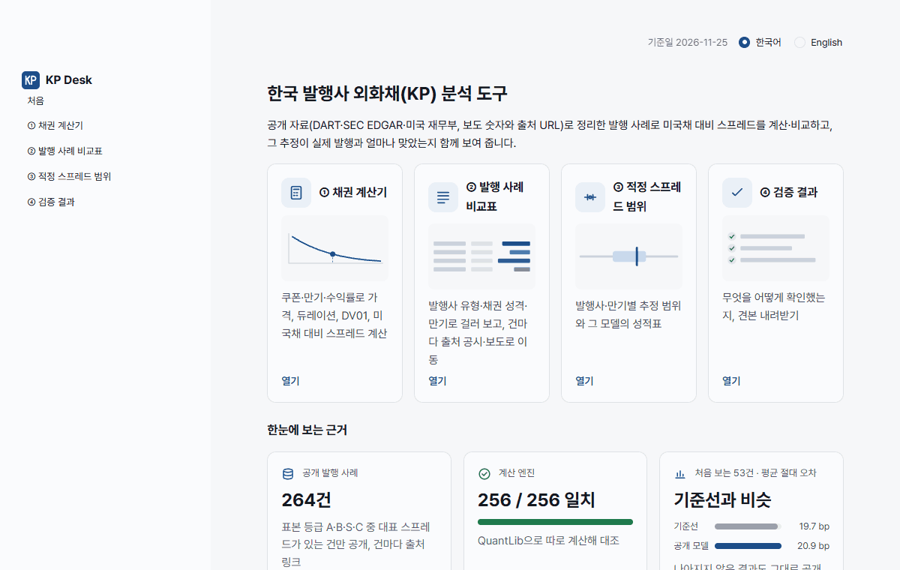
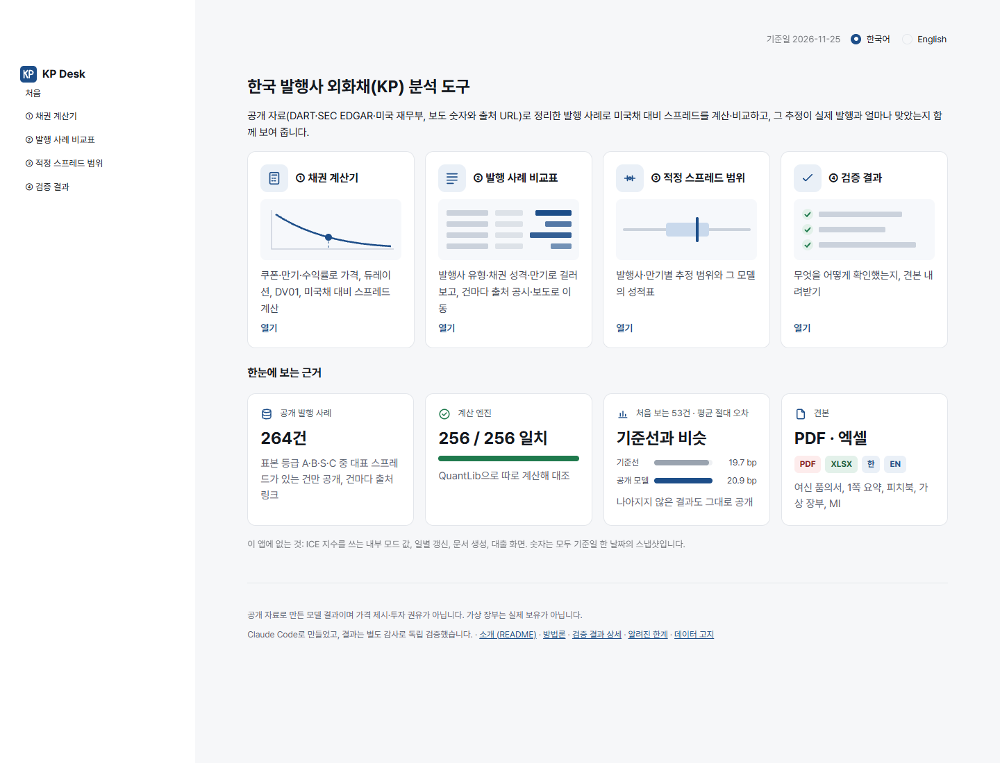
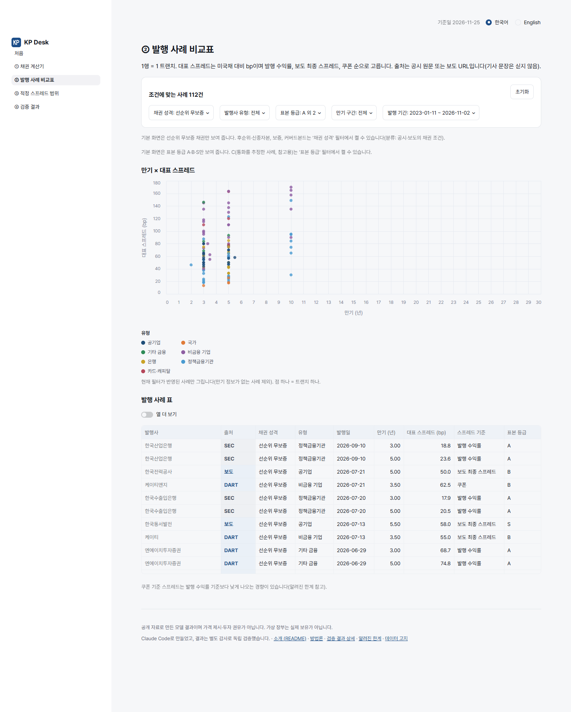

**KP Desk** — a public-data toolkit for foreign-currency bonds issued abroad by Korean issuers (KP): bond calculator, comparable deals, a model fair-spread range and its validation results, in Korean and English.
Every number is a one-date snapshot built only from public sources (DART, SEC EDGAR, US Treasury, press-reported numbers with URLs); it is not a price indication and not investment advice.
Built with Claude Code; results independently verified. English README: [README_en.md](README_en.md) · App: [https://kp-desk.streamlit.app](https://kp-desk.streamlit.app/?lang=ko)

---

# KP Desk (한국어)

한국 발행사가 해외에서 발행한 외화 채권(KP)을 공개 자료로 정리하고, **"이 발행사는 지금 미국채 대비 몇 bp가 적정한가?"** 를 모델 추정 범위와 그 검증 결과로 보여 주는 도구입니다.

> 공개 자료로 만든 모델 결과이며 가격 제시·투자 권유가 아닙니다. 견본의 장부는 가상 장부(실제 보유 아님)입니다.







## 앱 (4쪽 + 처음 화면, 한/영 전환)

앱 주소: [https://kp-desk.streamlit.app](https://kp-desk.streamlit.app/?lang=ko)

| 화면 | 내용 |
|---|---|
| ① 채권 계산기 | 쿠폰·만기·결제일과 수익률 또는 가격 → 가격·수익률·경과이자·결제 금액·듀레이션·볼록성·DV01, 기준일 미국채 커브 대비 G-스프레드·Z-스프레드 |
| ② 발행 사례 비교표 | 트랜치별 조건·채권 성격과 대표 스프레드, 공시·보도 출처 링크. 채권 성격(기본 선순위 무보증)·유형·표본 등급(기본 A·B·S)·만기·발행 기간 필터와 만기 × 대표 스프레드 산점도 |
| ③ 적정 스프레드 범위 | 공개 모드 대표 출력(N0 기준선)의 점 추정·범위와 같은 화면의 성적표 |
| ④ 검증 결과 | 채권 엔진 독립 대조, 가상 장부 평가 감사, 홀드아웃 1회 평가, 출력 감사, 견본 내려받기 |

화면 맨 위에서 한국어/English를 바꿀 수 있습니다(기본 한국어). 모든 숫자는 **기준일 한 날짜의 스냅샷**(`app/data/`)이며, 기준일은 앱 맨 위와 각 견본 첫 줄에 적혀 있습니다.

## 검증 요약

- 채권 엔진: QuantLib으로 다시 계산한 256건 모두 허용오차 안(불일치 0)
- 가상 장부 평가: 엔진 코드를 쓰지 않은 손계산과 90/90 비교 일치
- 홀드아웃 1회 평가(53건): 공개 모드 대표 출력은 N0 기준선(평균 절대 오차 19.7bp). 이 기간 N0 오차 중앙값은 +10.5bp(예측이 실제보다 높은 쪽)
- 자세한 숫자와 출처: [docs/VALIDATION_ko.md](docs/VALIDATION_ko.md) · 알려진 한계: [docs/KNOWN_ISSUES_ko.md](docs/KNOWN_ISSUES_ko.md)

## 문서

| 문서 | 한국어 | English |
|---|---|---|
| 방법론 | [METHODOLOGY_ko.md](docs/METHODOLOGY_ko.md) | [METHODOLOGY_en.md](docs/METHODOLOGY_en.md) |
| 검증 결과 | [VALIDATION_ko.md](docs/VALIDATION_ko.md) | [VALIDATION_en.md](docs/VALIDATION_en.md) |
| 알려진 한계 | [KNOWN_ISSUES_ko.md](docs/KNOWN_ISSUES_ko.md) | [KNOWN_ISSUES_en.md](docs/KNOWN_ISSUES_en.md) |
| 데이터 고지 | [DATA_NOTICE_ko.md](docs/DATA_NOTICE_ko.md) | [DATA_NOTICE_en.md](docs/DATA_NOTICE_en.md) |

## 실행

```
pip install -r requirements.txt
streamlit run app/Home.py
python -m pytest -q tests
```

Python 3.13. 데이터베이스·API 키 없이 돕니다(`app/data/` 스냅샷과 `src/bond/` 채권 엔진만 사용).

## 폴더

| 폴더 | 내용 |
|---|---|
| `app/` | Streamlit 앱(진입 `app/Home.py`), 화면 글자표 `app/i18n_strings.json`, 기준일 스냅샷 `app/data/` |
| `src/bond/` | 채권 엔진(가격·수익률·경과이자·듀레이션·커브 부트스트랩·G/Z-스프레드), 검증된 그대로 |
| `samples/` | 견본: 여신 품의서·1쪽 요약(PDF), 피치북·가상 장부 평가·MI 대시보드(엑셀), 한/영 |
| `docs/` | 방법론·검증·알려진 한계·데이터 고지(한/영) |
| `tests/` | 앱 화면(한/영) AppTest, 글자표, 채권 엔진, 묶음 점검 |

## 라이선스

코드와 문서: MIT ([LICENSE](LICENSE)). 데이터 출처별 조건은 [데이터 고지](docs/DATA_NOTICE_ko.md)를 보십시오.
