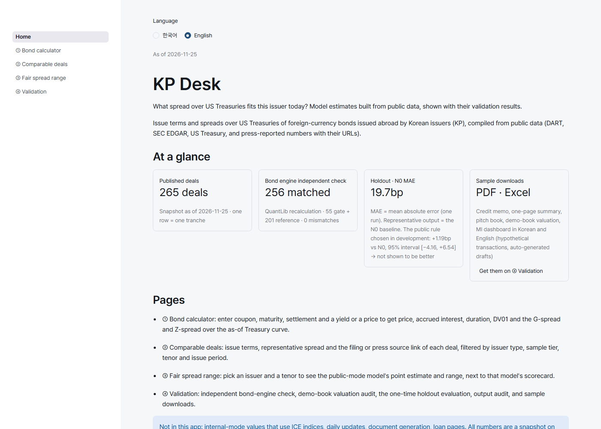
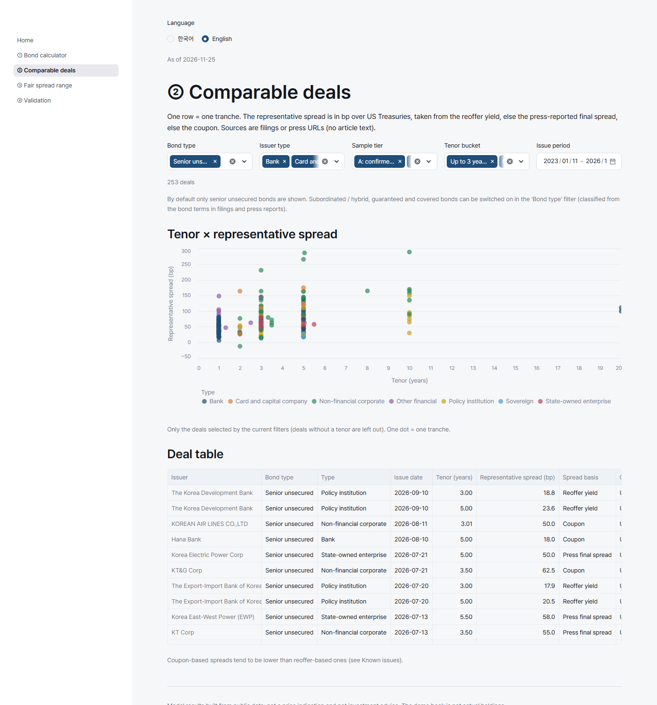

# KP Desk (English)

A toolkit that compiles foreign-currency bonds issued abroad by Korean issuers (KP) from public data and answers **"What spread over US Treasuries fits this issuer today?"** with a model estimate range shown next to its validation results.

> Model results built from public data; not a price indication and not investment advice. The book in the samples is a demo book - not actual holdings.

Built with Claude Code; results independently verified. Korean README: [README.md](README.md) · App: [https://kp-desk.streamlit.app](https://kp-desk.streamlit.app)





## App (4 pages + home, Korean / English)

App: [https://kp-desk.streamlit.app](https://kp-desk.streamlit.app)

| Page | Content |
|---|---|
| ① Bond calculator | Coupon, maturity, settlement and a yield or a price → price, yield, accrued interest, settlement amount, durations, convexity, DV01, and G-spread and Z-spread over the as-of Treasury curve |
| ② Comparable deals | Terms, bond type and representative spread of each tranche with its filing or press source link; filters by bond type (default: senior unsecured), issuer type, sample tier, tenor and issue period |
| ③ Fair spread range | Point estimate and range of the public mode's representative output (the N0 baseline), with its scorecard on the same page |
| ④ Validation | Independent bond-engine check, demo-book valuation audit, one-time holdout evaluation, output audit, sample downloads |

The language switch is at the top of every page (Korean by default). Every number is a **snapshot on one as-of date** (`app/data/`); the date is shown at the top of the app and in the first block of every sample.

## Validation in brief

- Bond engine: all 256 bonds recalculated with QuantLib were within tolerance (0 mismatches)
- Demo-book valuation: a hand calculation that does not use the engine code matched in 90/90 comparisons
- One-time holdout evaluation (53 deals): the public mode's representative output is the N0 baseline (mean absolute error 19.7bp). The median N0 error in that period was +10.5bp (predictions above the actual spreads)
- Numbers and sources: [docs/VALIDATION_en.md](docs/VALIDATION_en.md) · Known issues: [docs/KNOWN_ISSUES_en.md](docs/KNOWN_ISSUES_en.md)

## Documents

| Document | English | 한국어 |
|---|---|---|
| Methodology | [METHODOLOGY_en.md](docs/METHODOLOGY_en.md) | [METHODOLOGY_ko.md](docs/METHODOLOGY_ko.md) |
| Validation | [VALIDATION_en.md](docs/VALIDATION_en.md) | [VALIDATION_ko.md](docs/VALIDATION_ko.md) |
| Known issues | [KNOWN_ISSUES_en.md](docs/KNOWN_ISSUES_en.md) | [KNOWN_ISSUES_ko.md](docs/KNOWN_ISSUES_ko.md) |
| Data notice | [DATA_NOTICE_en.md](docs/DATA_NOTICE_en.md) | [DATA_NOTICE_ko.md](docs/DATA_NOTICE_ko.md) |

## Run

```
pip install -r requirements.txt
streamlit run app/Home.py
python -m pytest -q tests
```

Python 3.13. No database and no API key are needed (only the `app/data/` snapshot and the `src/bond/` engine).

## Folders

| Folder | Content |
|---|---|
| `app/` | Streamlit app (entry `app/Home.py`), on-screen string table `app/i18n_strings.json`, as-of snapshot `app/data/` |
| `src/bond/` | Bond engine (price, yield, accrued interest, durations, curve bootstrap, G / Z spreads), unchanged from its validated version |
| `samples/` | Samples: credit memo and one-page summary (PDF), pitch book, demo-book valuation and MI dashboard (Excel), KO / EN |
| `docs/` | Methodology, validation, known issues, data notice (KO / EN) |
| `tests/` | App pages (KO / EN) under AppTest, string table, bond engine, bundle checks |

## License

Code and documents: MIT ([LICENSE](LICENSE)). Terms of each data source: [Data notice](docs/DATA_NOTICE_en.md).
